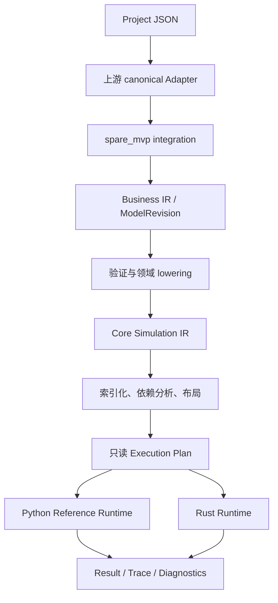

# 架构与模块边界

状态：Python reference 与独立 Rust 单样本/批量 runtime 已实现 canonical input → Execution Plan → result，并完成 B1/B2/B3 与 F35 三个 seed 的跨后端验收；批量执行通过 PyO3 暴露给 Python。Business/Core IR 分层物化、缓存及 agent 编辑仍按本文推进。

## 模型流转

## 职责与依赖

| 模块 | 拥有的职责 | 依赖边界 |
|---|---|---|
| `ir` | Business/Core/Plan 类型、版本元数据和来源定位 | 不导入领域、集成或执行器 |
| `compiler` | pass 编排、符号解析、单位检查、依赖分析、布局、计划验证和缓存 | 依赖 IR；由调用方注入领域插件 |
| `domains.aircraft_support` | 飞机保障语义、领域验证、lowering、操作定义与指标 | 依赖 IR 和编译扩展协议；不导入旧模型 |
| `reference` | 通用指令、事件日历、资源事务、随机协议、观测 | 依赖 Plan 和明确的 operation 实现；不解释 Project |
| `integrations.spare_mvp` | canonical 输入校验与导入、来源记录、上游结果映射 | 组合领域与编译入口；隔离上游依赖 |
| `rust/runtime` | 同一 Plan 的高性能实现及批量执行 | 只接受版本化合同；不依赖 Python 业务对象 |

初期允许版本化领域操作封装尚未拆解的兼容规则。操作必须显式注册输入输出、读写集合、时间与随机行为，以及每个后端的支持状态。未实现某操作的后端必须拒绝加载计划。逐步提取通用原语，第二领域阶段检验边界。

## 三层 IR

| 层 | 主要内容 | 约束 |
|---|---|---|
| Business IR | 稳定业务 ID、实体和关系、过程模板、规则、参数、指标、语义 profile | 面向人和 agent；表达式是受限 AST |
| Core Simulation IR | 类型化状态、事件、guard/effect、资源事务、时钟、采样点、指标归约 | 操作语义明确，能分析读写与唤醒依赖 |
| Execution Plan | 稠密索引、只读列式表、压缩邻接表、指令块、反向依赖、参数布局、source map | 由编译器生成；加载时检查版本、索引和后端能力 |

整个模型允许生命周期循环；仅局部作业前驱图等声明为 DAG 的结构做无环检查。编译候选关系和规则，不枚举未来随机路径。

## 任务—飞机—保障关系

- `MissionTemplate → MissionInstance → MissionSlot` 描述需求；`AircraftBinding` 在运行时选择和预约飞机。起飞前替补与起飞后补充出动是不同规则。
- `ProductType` 共享目录参数；`ComponentSlot` 表示安装位置；`ComponentInstance` 持有单机组件状态。组件数量的兼容含义需单独核验。
- `SupportProcessTemplate / WorkStepTemplate` 描述保障；`SupportProcessInstance / WorkStepInstance` 持有本次运行进度、触发来源、对象及预约凭证。
- 任务消耗飞机可用性，保障占用人员、设备和库存，保障结果改变后续任务的可行性。静态定义与运行绑定分别存储。

## 编译阶段

1. 验证输入来源、schema、语义 profile，记录默认值来源。
2. 解析稳定 ID、实体引用、类型、单位和参数绑定。
3. 展开确定性任务实例及适用关系，保留运行时选择。
4. 将领域规则 lowering 为 Core 操作，校验图与后端能力。
5. 建立状态写入到 guard/等待者/指标的反向依赖；时间条件生成定时唤醒。
6. 分配紧凑索引和状态布局，进行有证据支持的常量折叠等优化。
7. 输出 Plan、参数合同、源映射、指纹与诊断；验证后方可缓存。

每个 pass 定义输入、输出、前置条件与可验证的不变量。优化前后保持同一语义 profile；无法证明兼容的优化单独立项。

## 执行边界

`ExecutionPlan` 只读共享；每个样本独立创建 `RunState`，包含状态数组、事件堆、活动过程、库存账本、预约、随机计数器及指标累积值。历史作业离开调度热路径。Rust 目标为 `Arc<ExecutionPlan>` 加每样本独立状态。

事件排序目标为 `(time, microstep, phase, sequence)`。兼容 profile 的 phase 表、可见性与下一分钟唤醒规则需先从旧模型提取。版本化 owner handle 和 timer token 丢弃取消或槽位复用后的旧事件；零时间循环受事件数和 microstep 预算约束。

资源区分可释放容量、消耗库存、预约和在途量。按照 profile 定义分阶段事务，不把“先预约备件再等待人员”擅自改为一次性全资源申请。取消与完成凭预约凭证只结算一次。

故障时钟显式区分日历与飞行暴露量。采样时机、维修后的年龄恢复规则、取整和分布变换均属于语义合同。随机流以稳定实体身份定位；兼容模式还需固定旧 RNG 的算法与调用顺序。

Python/Rust 以计划和批量运行请求交互，避免逐事件跨语言回调。批量请求以输入位置作为稳定 `sample_index`，允许重复 seed；Rust 线程池共享 `Arc<ExecutionPlan>`，每个样本创建独立 RunState，完成后按 `sample_index` 排序。线程数变化已验证不改变逐样本结果。summary/analysis/debug 观测级别不改变模型状态、随机抽样或事件调度；当前正式基准仍使用全量 result 观测。

## 创作模式与未来扩展

原型为 `project-import`：Project 是真源，Business IR 为派生产物。原 Project 字段修改回到上游，再重新导入。未来 `ir-native` 模式以 ModelRevision 为真源，显式记录一次性导入来源。

阶段 D 增加补丁、影响分析、验证、编译与版本发布。正在运行的任务固定模型修订；新补丁生成新修订和新运行。运行中状态迁移另行设计。

当前不拆服务，不接 UI 或数据库。先验证离散事件任务—资产—资源系统；未来物理求解器通过明确接口接入。
