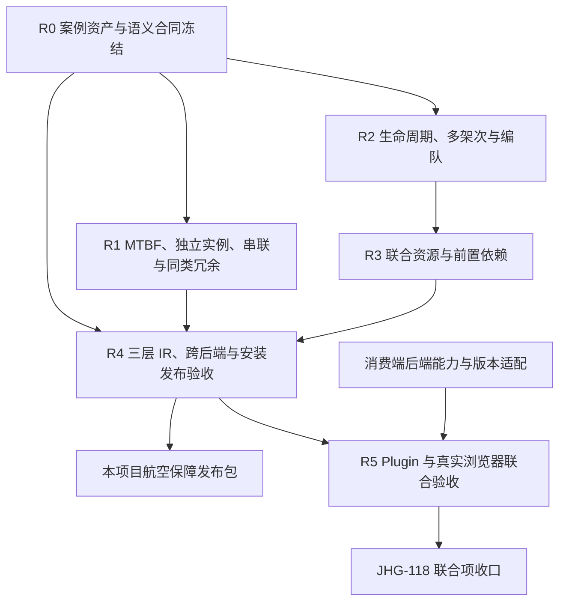

# 航空保障领域案例库与 IR 编译运行发布包收口计划

日期：2026-11-11。项目定位、分类及本轮门槛按本次用户决定更新。本文规定待交付范围，不代表实现、仿真验收或发布已经完成。GitHub Issue 保留具体技术合同，Linear 项目维护分类、阶段和依赖关联。

## 项目交付与本轮发布边界

项目交付三项资产：航空保障领域案例与语义基准、三层 IR 编译运行包、可复核的验收发布证据。领域范围限定航空任务、飞机、组件、故障维修、备件与保障资源；保留可复用编译器和执行内核的边界，不为案例名添加 runtime 分支。

本轮发布以 R0–R4 为门槛：固定五个航空案例及可靠性小例，使业务约束完整通过 Business IR → Core IR → Execution Plan，并由独立 Python reference / Rust runtime 执行，完成仓库外安装与版本验收。沿用已有 Aircraft v0.1 CLI/SDK 与 `.simpack`；本轮语义修订、迁移和具体版本号必须在候选冻结时明确，本文不指定新版本号或 tag。

| 维度 | 本轮范围 | 不纳入本轮门槛 |
| --- | --- | --- |
| 案例资产 | GC-01-A01、GC-02-A02、GC-03-A03、GC-12-A12、GC-13-A13；串联、同类冗余与独立维修小例；既有航空原生目录登记 | 所有 107 原生案例进入本引擎、108 例/全部变体通过、SIMLOX 全面等价 |
| 语义 | 生命周期、多架次、编队、联合机型资源、前置依赖；单体 MTBF、独立实例故障维修、默认串联与同类实例 `k_out_of_n` | 通用 Reliability 语言、异构组件 K-out-of-N、任意领域或任意故障分布/时钟 |
| 包与运行 | 复用 CLI/SDK、`.simpack`、原生 Rust 与独立 Python reference；现有 Linux x86_64、Python ≥3.12、Rust 1.90.0 构建边界；冻结实际依赖版本 | 自动扩大平台、indexed Plan bundle、完整 Rust/WASM 产品或新后端 |
| 证据 | 来源/版本/指纹、稳定身份、真实事件/资源账本/终态、随机 tape、Oracle 对照、复现命令和限制 | 完整 SysML、通用因果诊断、新性能收益、部署/认证/计费承诺 |
| 消费端 | 提供公开包、合同与参考模型，支持适配问题定位 | Plugin/Cloud 全部用户交互、页面、保存、浏览器、线上与付费验收 |

R5 是 Plugin 的独立集成里程碑，不再是本项目原生发布包的统一前置。JHG-118 的跨仓库总项仍要在 Compiler 与 Plugin 两端分别通过原验收后才能关闭；本项目发布通过不能提前关闭 JHG-119 或 JHG-118。

## 案例来源与支持声明

- `simulation-case-library` 的 Aircraft Golden Chains 通过固定 revision、案例路径、需求/输入/Oracle 指纹关联，复用权威来源，不复制出另一套 Project JSON 解释器。
- #18 的原生案例留在 `simlox/main`；按最新首版口径保留 107 个非 GUI 案例 ID 至少有一组输入输出、ASCII 内容、GUI 排除及 PR #557/#558 的既有交付。广义边界和变体扩充仍为后续工作，不重启首版已取消的门槛。
- 本轮登记既有目录、输入输出引用与交付位置，关联五个编译执行适配案例；来源原生案例、可编译案例、按后端已验收案例使用不同字段记录。不能把原生输入输出存在写成本引擎支持。
- 可分发的模型/Oracle/索引随发布资产固定版本；不可分发或本轮不可用的原始文件只保留来源、摘要和可用性说明。合成数据明确标 synthetic，不得替代缺失原始证据或伪造复现。
- 源快照、Oracle 与生成运行结果分开存放。重新生成的结果不能覆盖旧源证据；语义修订的期望变化与旧兼容 profile 的保持条件分别验收。

## 当前必须完成

R0–R5 是工作包标识，不是新增 Issue。优先复用现有主项和执行卡，避免再建一层总任务。

| 工作包 | 现有任务与依赖 | 可验证完成条件 |
| --- | --- | --- |
| R0 案例与合同冻结 | JHG-120 / #559；#18 的既有目录登记；无前置 | 五案例来源/输入/Oracle/版本及可靠性小例齐全；固定单位、时间/RNG/work profile、后端矩阵、默认值、支持范围和负例。来源目录与执行覆盖可区分，缺失原始文件不宣称新验证 |
| R1 可靠性语义 | #560 / PR #561；依赖 R0 的可靠性合同 | 单体 rate=1/MTBF，quantity 不改单体率；各实例独立故障、维修与重采样；不同分系统默认串联；同类实例组用 `k_out_of_n`，包括 1-out-of-2 的单故障/双故障/维修恢复。Python/Rust lowering、执行与观测一致，旧字段与包有显式迁移或拒绝 |
| R2 生命周期与编队 | JHG-120 / #559；依赖 R0 | GC-01/02/03：基础任务；同机在 8/20/32 小时的独立架次；准备/航后恢复实际限制后续出动；任务波次和飞机架次分别计数，逐飞机身份保留；最低起飞数、延迟、取消与释放有正反例 |
| R3 联合资源与依赖 | JHG-120 / #559；依赖 R0、R2 的任务身份/状态合同 | GC-12：两个 A+B 任务争用唯一 B，只交换优先级就交换完整获配任务，未满足联合需求的一方不能部分起飞，取消释放守恒。GC-13：前置未完成不得执行；失败/取消/延迟按声明策略处理；循环、悬空引用明确拒绝。约束完整跨三层 IR 并实际影响结果 |
| R4 包、证据与发布验收 | JHG-120；依赖 R0，随 R1–R3 增量实现，最终依赖其验收 | 五案例与可靠性小例通过 Python/Rust；稳定任务/飞机/架次/实例身份和来源、Plan 指纹、真实事件/随机请求/指标/账本/终态齐全；仓库外安装候选 wheel 后通过示例、修改、seal、validate、compile、run、batch、diff；记录摘要、版本、命令和限制 |
| R5 消费端联合验收 | JHG-119 / Plugin #8；JHG-118 汇总；依赖 R4 对应包合同和消费端后端能力 | 实际 Plugin 五案例字段不丢失，Check/Compile/Run/Result 分阶段记录；浏览器后端按同 Plan 业务断言验收，错误完整回传，模型/Plan/Run/Result 关联，复跑有证据；部署与计费按所属产品合同另验 |

联合飞机资源完整性不意味着改变既有备件预约/人员等待的分阶段事务；新增通用操作仍须先论证已有 IR 无法表达的最小缺口，并提供至少两个不同组合的合同测试。

### R1 的确定业务合同

本节采用 [PR #561 业务澄清评论](https://github.com/jihegao/sim_engine_compiler/pull/561#issuecomment-6793026336) 中用户确认的定义，替代先前把父系统 `failure_threshold` 当作有效业务规则的表述。

1. 飞机包含 A、B 等不同组件/分系统时，默认串联：A 和 B 都必须完好；任一失效向上层传播。不能使用父级 `failure_threshold=2` 允许一个必需分系统失效后整机仍完好。
2. 只有多个相同组件实例构成的冗余组使用 `k_out_of_n`。两个 A 并联、2 中取 1 表达为 `k=1,n=2`：一个故障仍完好，两个故障才使组失效。K 是最少完好实例数，N 对应实际组内同类实例数；quantity 不隐含并联关系。
3. 不引入 `failure_threshold` 作为业务配置或冗余的并列表达。`k_out_of_n` 的 k/n 范围、实例绑定和默认串联必须跨 Business/Core/Plan 一致；非法 k/n、N 与实例数不符及不同组件混组应明确拒绝。
4. 每实例独立 MTBF/故障时钟/维修状态；维修仅恢复目标实例、按合同重采样一次，重新计算组状态并按上层串联关系传播。冗余不改变单体 rate=1/MTBF。
5. 保留当前航空 MTBF 的指数分布、hour/flight_hour 边界和地面暂停规则。新语义不能暗中沿用旧数量缩放、修改单体率的 K-out-of-N 公式或父节点阈值逻辑。
6. 既有 `failure_threshold` 输入、Plan、缓存与包的处理必须有版本和显式迁移/拒绝策略，不能静默忽略或在运行时猜测。旧 golden 留存，新增语义的期望结果单独版本化；未受影响配置继续回归。

PR #561 当前 head 为 `63bd842cedf47f40c4f326510ac82766c9076eec`，其说明仍明确拒绝启用 `k_out_of_n`，并保留组件节点级阈值。因此它属于本轮必须审查调整的实现切片，不是本节合同已经通过的证据。仅合并现有独立实例实现不能关闭 #560，也不能完成 R1。若暂未实现冗余，必须明确拒绝并保持 R1 对应验收未通过，不能用 `failure_threshold` 代替。

### R4 的发布通过条件

- 五案例和可靠性正反例有固定输入、独立 Oracle/手算断言，逐层检查语义保持；不只检查 Schema、字段存在或进程成功退出。
- 相同冻结 Plan/配置/seed 的 Python/Rust 随机请求、事件顺序、指标、终态与资源账本按合同对照；离散身份与状态精确比较，浮点容差限于明确数值变换。受影响 minute/event-time 与 full/summary 组合分别验证。
- 既有 B1/B2/B3、F35 seeds 0/1/7 和批量重复 seed、稳定 sample_index、线程隔离回归按变更影响执行；新语义改变 quantity/RNG 时，区分兼容证据与新版语义证据。
- 对未知 op/profile、非法单位/引用、包身份不匹配、旧 `failure_threshold`、不支持的后端组合有清晰错误和负例，不能忽略后继续运行。
- 用候选 wheel 在源码目录外安装并执行公开 CLI/SDK；随包或配套版本化资产交付案例入口、模型包、支持矩阵、迁移说明、摘要和复现命令。内部脚本可用于差分，不能充当唯一消费入口。
- 列出版本、IR/profile/平台/后端、原始与生成产物位置、实际执行与未执行检查。必要检查缺证据时发布门槛保持未通过；豁免不计为通过。完成门槛后再冻结发行版本和发布，本文更新不等于生成或上传发行包。

### R5 的消费端边界

[JHG-28](https://linear.app/jhgao/issue/JHG-28) 的最新架构决定仍适用于相关产品：用户页面、仿真计算和可视化在用户浏览器执行；未来云端 Rust 产品需先完成适用计费与准入。项目定位调整不改变这个决定。

本项目可在 R4 通过后独立发布原生包。若浏览器暂不支持该 Plan/profile，R5 保持真实阻塞，不能以 Python/Rust 通过冒充浏览器通过，也不能在 Plugin 适配层复制模型规则或擅自改走云端。若消费端选择 Rust/WASM，仅把实际需要的 #551 子集列为 R5 的依赖，完整 WASM 不自动升级为 R4 前置。

## 全部开放 GitHub Issue 和 PR 分类

三类标签只表示相对于本轮航空发布的归属，不修改 open/closed、draft、Done、原验收结果或其他产品排期。#10/#11 的完整范围后置，已有基础身份与事实输出由 R4 复用。#18 的标签覆盖既有资产登记，不把原 Issue 的广义研究范围全部纳入本轮。

| 分类标签 | Issue / PR | 本轮处理、依赖与关闭条件 |
| --- | --- | --- |
| `aircraft:release` 当前必须完成 | [#559](https://github.com/jihegao/sim_engine_compiler/issues/559) / JHG-120 | 主线 R0–R4；五案例和包验收完成后按本仓合同收口，与 Plugin 的 R5 分开 |
| `aircraft:release` | [#560](https://github.com/jihegao/sim_engine_compiler/issues/560) | R1；按上述串联/同类实例 `k_out_of_n` 完成校验、转换、执行和迁移 |
| `aircraft:release` | [PR #561](https://github.com/jihegao/sim_engine_compiler/pull/561) | R1 实现切片；优先审查独立实例与传播语义，修正与最新业务合同不符的阈值逻辑/测试，不能凭现有 PR 说明认定 #560 已关闭 |
| `aircraft:release` | [#18](https://github.com/jihegao/sim_engine_compiler/issues/18) | R0 既有航空案例资产登记；复用首版输入输出和交付索引，保留 107 原生案例与本引擎覆盖的区别；全变体扩充后置 |
| `aircraft:extension` 后续扩展 | [#10](https://github.com/jihegao/sim_engine_compiler/issues/10) | 完整模型审阅/SysML；依赖稳定语义映射，真实 parser 与业务映射断言验收。基础来源身份复用到 R4，不要求本轮交付完整 SysML |
| `aircraft:extension` | [#11](https://github.com/jihegao/sim_engine_compiler/issues/11) | 完整追溯/阻塞诊断；声明采集预算、关联缺失和后端/profile 支持；基础事件事实进入 R4，已有有限查询不等于完整诊断 |
| `aircraft:extension` | [#549](https://github.com/jihegao/sim_engine_compiler/issues/549) / JHG-26 | ABM 公开包；按实际 Cloud C5/C6 合同与两个配置的公开入口/Python-Rust 验收，不因新航空版本自动获得支持 |
| `aircraft:extension` | [#550](https://github.com/jihegao/sim_engine_compiler/issues/550) / JHG-27 | 通用 DES/排队/机场；先审计操作，再以至少两种 IR 组合、资源守恒和跨后端验证；空间运动另列缺口 |
| `aircraft:extension` | [#551](https://github.com/jihegao/sim_engine_compiler/issues/551) / JHG-28 | Rust/WASM；先选 profile/ops 并固定工具链、包/worker 身份；同 Plan/seed 原生-WASM、真实浏览器与取消释放验收；R5 是否依赖按实际接入决定 |
| `aircraft:extension` | [PR #554](https://github.com/jihegao/sim_engine_compiler/pull/554) | 受限双服务台队列/profile/查询草稿；核对当前 main 整合、独立合同和航空回归，不作 R4 前置，不因单个受限队列通过关闭 #550 |
| `aircraft:extension` | [PR #555](https://github.com/jihegao/sim_engine_compiler/pull/555) | 工具链说明草稿；base 是 #554 分支，随父分支处理或单独摘取已验证文档；不能为合说明而提前合整个 #554 |
| `aircraft:research` 独立研究 | [#6](https://github.com/jihegao/sim_engine_compiler/issues/6) / JHG-11 | CPU 三臂/候选派遣；语义接受后冻结环境和测量，分别记录 compile/init/run/end-to-end/RSS，结论允许不采用 |
| `aircraft:research` | [#3](https://github.com/jihegao/sim_engine_compiler/issues/3) | GPU/统计加速；明确精度目标与 CPU 基线，包含传输及总成本；无生产 GPU/JIT/分布式隐含承诺 |
| `aircraft:research` | [#13](https://github.com/jihegao/sim_engine_compiler/issues/13) | 风电公开基准；固定源码/输入并建立独立语义参考后再计时，论文历史值不能直接作本引擎 Oracle |

PR #27 已于 2026-10-10 合并，交付三臂测量工具与历史负面证据；AMD128 99/99 cells、0 benefit、29 regression、4 未证明收益的结论保留。合并记录仍明确 fresh MLIR 三臂差分未做，无新性能/采用收益结论。JHG-11 按独立研究核对残余验收，不自动重跑大规模测量。

## Linear 任务归属与消费端关联

| 任务 | 分类与本轮职责 | 状态处理 |
| --- | --- | --- |
| [JHG-120](https://linear.app/jhgao/issue/JHG-120) | `aircraft:release`；加入本项目，承接 R0–R4，保持 JHG-118 子项关系；Compiler 合同是 JHG-119 完整集成验收的依赖 | 不提前改为完成 |
| [JHG-10](https://linear.app/jhgao/issue/JHG-10) | 已交付发布基础；#29 / PR #49 的 v0.1 CLI/SDK/.simpack 复用 | 保持 Done，不重建同一开发任务 |
| [JHG-26](https://linear.app/jhgao/issue/JHG-26)、[JHG-27](https://linear.app/jhgao/issue/JHG-27)、[JHG-28](https://linear.app/jhgao/issue/JHG-28) | `aircraft:extension`；GitHub 为完整执行卡，Delivery Project 管相应产品排期 | 保持已有归档与 Backlog，不恢复为活跃任务，也不改变 JHG-28 浏览器执行决定 |
| [JHG-11](https://linear.app/jhgao/issue/JHG-11) | `aircraft:research`；校正 PR #27 已合并与未验证边界 | 保留原状态、历史负面结果与残余验收 |
| [JHG-32](https://linear.app/jhgao/issue/JHG-32)、[JHG-37](https://linear.app/jhgao/issue/JHG-37)、[JHG-39](https://linear.app/jhgao/issue/JHG-39)、[JHG-40](https://linear.app/jhgao/issue/JHG-40) | `aircraft:extension`；相对本项目属于消费端/推广工作。37 的自然语言 A01、39 的全链产物追踪可消费 R4 合同，40 多案例推广后置。R4 自身来源/结果身份仍必须完成 | 不因本轮排除就标 Duplicate/Done，保留原端到端验收要求 |
| [JHG-66](https://linear.app/jhgao/issue/JHG-66)、JHG-70/71/72 | `aircraft:research`；按已选需求收齐 Agent 扩展 IR 实验证据与结论 | 不将失败或能力缺口伪装成功；已完成 67/68/69 不重做 |
| [JHG-119](https://linear.app/jhgao/issue/JHG-119)、[JHG-118](https://linear.app/jhgao/issue/JHG-118) | 外部消费端和联合协调，R5 独立验收；保留原层级 | 本仓发布通过不能关闭浏览器/联合项 |
| [JHG-83](https://linear.app/jhgao/issue/JHG-83)、JHG-85、JHG-89、JHG-96 | 全面案例验证、资源边界与 LRU 实验；可引用证据，全面推广后置，不成为 R4 新增门槛 | 原状态与结论保留；多种 LRU 类型实验不能替代同型 quantity>1 独立实例测试 |

项目分类更新不移动其他仓库的发布责任，不自动关闭实验父项，不把 deck_sim、青岛项目收尾、ship_designer 的 AnyLogic、数据库、页面或空间动画作为本轮依赖。

## 发布依赖与停止条件

R0–R4 通过后，本轮发布范围即收口；不因新增案例、UI 请求、性能候选或完整 WASM 尚未完成而持续扩张。R5 保持自己的完成条件。静态文档检查、实现合并、语义验收、发行包生成、产品部署分别报告。

本次文档提交基于远端 main `5900513b3d3d9c581d50ff904dd460c984afbc96`；最初范围梳理的本地起点为 `a1a44c72`。PR #561/#554/#555 的远端状态在 2026-11-11 核对。实现和正式验收须重新冻结实际 main/PR head，本文不复用旧 CI 结果作为新语义验收。
