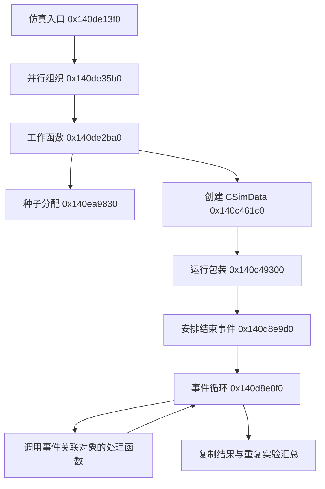

# SIMLOX 2017 仿真算法与计算流程分析

本机 SIMLOX 是以任务、故障、维修、资源和备件供应为对象的离散事件随机仿真器。主程序中的静态调用链已连接到事件日历和每次重复实验的随机状态；随附手册提供了任务派遣、维修物流和统计指标的业务规则。以下区分二进制观察、手册规定与尚未验证的实现细节。

## 分析对象和证据

| 项目 | 实际值 |
| --- | --- |
| 主程序 | `C:\Program Files\Systecon\SIMLOX\Simlox.exe` |
| 产品版本资源 | `2017,0,0,0` |
| 格式 | PE32+，x86-64，原生程序，无 PE/CLI 元数据目录 |
| 文件大小 | 33,196,032 字节 |
| SHA-256 | `fe24c5bffc0c0641894bb335484cfb83993e3db2bd60122ddadfedd39a8c4db0` |
| 首选映像基址 | `0x140000000`；下文地址均为静态分析地址 |
| 工具 | REA 6.4.0、Ghidra 12.1.4、pefile、Capstone、pypdf |

原分析工作区的 REA 返回值及普通 PE/汇编解析分别保存在 `output/evidence/rea` 与 `output/evidence/binary`。本仓库提供相对路径的审阅摘出副本、证据编号和来源哈希；原始返回值、证据包及会话快照留在分析机器。手册为随安装提供的 996 页 `UserDoc\SIMLOX.pdf`。已核对的引用中，PDF 物理页码与手册印刷页码一致。安装文件保持只读；结论来自静态分析，未将分析工具运行表述为 SIMLOX 的实际仿真执行。

REA/Ghidra 默认自动分析已成功完成，本次取得 38 个函数的结构化分析结果，包括汇编、反编译、调用关系和 Evidence ID。反编译中的参数类型和浮点调用签名有明显推断误差，例如构造函数的栈参数和数学函数的 `SUB84` 表示；本报告用对应指令核对参数传递，不把这些类型推断当作恢复的源码。

组织函数、仿真构造函数和工作函数的 `native_value_flow` 子字段标记为截断；它们的已保存汇编和伪代码仍可独立检查。未把这些有限的函数内数据流图当作完整的跨函数证明。Ghidra 日志中的类型／数据创建警告保留于原分析工作区，自动分析最终报告成功。会话已关闭，主程序 SHA-256 在分析后重新核对一致。

主要入口：

- [REA 证据索引](simlox-2017-static-analysis/evidence/rea/evidence-index.md)
- [仓库审阅包与来源清单](simlox-2017-static-analysis/README.md)；原始证据包和快照仅列哈希，不随 PR 分发
- [汇编证据与函数索引](simlox-2017-static-analysis/evidence/binary/binary-findings.md)
- [手册规则与页码](simlox-2017-static-analysis/evidence/docs/findings.md)

| 核心结论 | REA/Ghidra 反编译摘出副本 |
| --- | --- |
| 并行组织和单次实验 | [组织函数](simlox-2017-static-analysis/decompiled/function-orchestrator.c)、[工作函数](simlox-2017-static-analysis/decompiled/function-worker.c)、[CSimData 构造](simlox-2017-static-analysis/decompiled/function-sim-constructor.c) |
| 事件循环与排序 | [循环](simlox-2017-static-analysis/decompiled/function-event-loop.c)、[比较函数](simlox-2017-static-analysis/decompiled/function-event-order.c) |
| 种子分配与随机内核 | [种子分配](simlox-2017-static-analysis/decompiled/function-seed-allocation.c)、[MT 内核](simlox-2017-static-analysis/decompiled/function-mt19937.c)、[Lehmer](simlox-2017-static-analysis/decompiled/function-lehmer.c) |
| 正态与零值裁剪 | [正态内核](simlox-2017-static-analysis/decompiled/function-boxmuller.c)、[外层裁剪](simlox-2017-static-analysis/decompiled/function-normal-wrapper.c) |
| 其他分布 | [Poisson](simlox-2017-static-analysis/decompiled/function-poisson.c)、[Gamma](simlox-2017-static-analysis/decompiled/function-gamma.c)、[三角形](simlox-2017-static-analysis/decompiled/function-triangular.c)、[混合分布](simlox-2017-static-analysis/decompiled/function-user-distribution.c) |
| 提前停止和误差公式 | [连续计数](simlox-2017-static-analysis/decompiled/function-results-merge.c)、[是否继续](simlox-2017-static-analysis/decompiled/function-stop-check.c)、[相对误差](simlox-2017-static-analysis/decompiled/function-relative-error-formula.c) |

每个摘出文件头保留对应原始返回文件名和完整 Evidence ID。证据索引可追溯到原始返回值的哈希及完整汇编；本仓库的 JSON 是明确标识的审阅摘出，不是未改写的 canonical Evidence。

## 仿真执行链

以下箭头表示已定位的静态调用或工作函数绑定关系；方法名称为便于理解而赋予的语义标签，地址是实际定位结果。



组织函数绑定工作函数并创建、等待线程任务。工作函数领取种子和重复实验编号，把种子传给 `CSimData` 构造函数；构造函数把随机状态写到对象偏移 `+0x10`。运行包装把仿真时长写到 `+0xc0`，再进入事件日历。最后的结果复制和跨实验汇总由工作函数和结果控制器衔接，具体指标公式以手册证据为主。

核心事件循环的可读等价流程是：

```text
安排 SIMPE 时刻的结束事件
检查运行／停止标志
循环：
    取得下一 event_notice
    若下一事件是结束标记，离开事件循环
    保存当前事件及其关联对象
    当前仿真时间 = notice 的时间字段
    从日历移出 notice
    调用关联对象的虚函数槽 +0x10
    清理 notice
    检查停止标志，再取下一事件
```

这段循环包含多个 PE 异常展开区间，不能把三个 `.pdata` 条目当作三个独立业务函数。它按事件推进时间，没有在这段内核中按 `RCINT` 等固定统计步长推进。

`event_notice` 比较函数 `0x140d8ea60` 的排序为：

1. `double +0x18` 升序，已与仿真当前时间的写入对应。
2. 时间相等时，`signed int +0x20` 降序。
3. 前两项相等时，`double +0x28` 升序。

第二项可解释为优先级候选，第三项是附加排序键；其完整业务含义、完全相等时是否保持插入顺序仍未证明。结束事件设第二项为最小有符号整数，并使用较大的第三项，符合在同时间普通事件之后结束的意图；完整边界行为仍应由实际事件日志确认。日历容器的全部插入、取消和排序实现不在本次完整恢复范围内。

## 随机数和重复实验

### 单次实验中的 Lehmer 采样流

均匀随机数内核 `0x140d8e3b0` 的状态更新已由指令和常数定位：

```text
x_next = (1220703125 × x) mod 2147483648
U = x_next / 2147483648
1220703125 = 5^13
```

机器编码乘数是 `0xc8c27395`，清除结果第 31 位后，与上述模 `2^31` 的乘数等价。`0x140c4aa00` 对 `CSimData +0x10` 的状态调用该内核，返回 `lower + U × (upper - lower)`。正态、对数正态和指数采样中也观察到同一更新方式。手册第 230 页所说的 Lehmer 方法因此获得二进制支持。

### 重复实验之间的种子处理

`0x140ea9830` 在互斥保护下分配种子和实验编号：首次取保存的原始种子，后续调用种子处理器的虚函数槽 0。已恢复的 `CMersenneTwisterSeedHandler` 经 `0x140ea97c0` 进入 `0x140ea9700`；其状态长度、twist 和 tempering 常数组合支持 MT19937 家族识别。

因此，**重复实验种子处理层使用 Mersenne Twister，单个实验内部的分布采样使用 Lehmer**。手册的“单随机流”不能扩展成所有并行实验共享一个可变 Lehmer 状态。每个仿真实例保存自己的状态；线程任务领取实验种子的过程受锁保护。跨线程运行时的完成顺序、结果累加顺序和位级一致性未实测。

### 已定位的分布实现

| 分布或操作 | 地址 | 静态观察 |
| --- | --- | --- |
| 确定值 | `0x140e47cd0` | 直接返回给定值 |
| 连续均匀 | `0x140c4aa00` | `a + U(b-a)` |
| 指数间隔 | `0x140d8e640` | 正率时计算 `-log(U)/rate`；非正率返回 `1e10` 哨兵值 |
| 正态内核 | `0x140d8e6c0` | Box–Muller 形式的 log、sqrt、cos 运算 |
| 正态外层 | `0x140e47db0` | 采样一次，非正结果置零，没有拒绝重采样循环 |
| 对数正态 | `0x140d8e550` | 正态形式计算后经 exp 变换 |
| 用户混合分布 | `0x140e47e30` | 按累计权重选子分布，虚调用其采样槽，随后按给定均值与混合均值比缩放 |
| Gamma | `0x140d8e3d0` | 对整数形状参数累加对数项，属于 Erlang 构造；见下文边界 |
| Poisson | `0x140d8e770` | 均值不超过 25 时用均匀乘积法，大于 25 时用正态近似 |
| 三角形 | `0x140d8eb10` | 三个连续 Lehmer 值构造，仅保存第一次状态更新 |

正态内核计算两个相邻的 Lehmer 值，但只把第一次更新写回外部随机状态；角度常数为二进制中的 `6.283185307`。若要复现事件序列，需保留这种状态消费方式和实际常数，不能用任意随机库替代。

手册第 544 页称正态在零处左截断。程序外层的实际操作是把非正值直接置零；这在概率分布上与对负值拒绝重采样不同，会保留零点概率质量。这里只陈述实现差异，不据此判断设计意图或统计质量。

**Poisson。** `λ <= 0` 返回零；`0 < λ <= 25` 先令 `P=U1, k=0`，当 `P > exp(-λ)` 时增加 `k`、继续产生均匀数并乘到 `P`，最终返回 `k`。每次更新都保存随机状态。`λ > 25` 使用上述正态内核，以 `μ=λ, σ=sqrt(λ)` 抽样，向零截断为整数，负整数置零。这个分支使用正态近似，没有观察到精确泊松拒绝采样或四舍五入。

**Gamma。** 子类包装把输入的 `Beta` 取倒数作为内核率参数。内核对 `n >= 1` 依次计算连续均匀值的对数，返回 `-Beta × Σ log(U_i)`；正整数 `n` 时就是 `n` 个指数项之和。有限非整数 `n >= 1` 时，循环次数为 `floor(n)`；`n < 1` 时不进入循环。`U=0` 时先加 `2.220446049250313e-16`。整个循环只在第一轮把状态写回外部。这些是内核行为；输入层是否限制 `n` 为正整数、如何拒绝非法 Beta，尚未核对。

**三角形。** 经子类和仿真包装的寄存器重排，内核参数为下界 `a`、上界 `b`、众数 `c`，输出为 `c + [a + (b-a)U1 - c] × max(U2,U3)`。三个值来自连续 Lehmer 更新，只有 `U1` 对应状态写回；不能替换成消耗三个外部状态的库函数。`a <= c <= b` 等输入校验不在本次已核实范围内。

## 故障和维修如何带动事件

以下业务规则来自手册，并由相关类型名和函数入口辅助定位；未逐一恢复所有业务分支。

**故障生成。** 第 189–192 页规定故障服从泊松过程，故障间隔为指数分布。传统模型按系统／零件故障率和应用因子形成强度，再沿物料结构按故障率份额定位故障；同一零件在一次任务中只失败一次，系统可有多个故障。FailureMode 模型显式描述一个故障的多个替换后果。已找到 `CFailEventGen`、`CFailureGen` 和“下一随机故障”的日志函数 `0x140c594c0`；完整的多参数倍率、非关键升级和剩余故障时间处理仍需逐分支跟踪。

**损伤生成。** 第 192–193 页区分 `DAMP` 与 `DAMRT`：前者按任务抽发生与否，发生时刻在任务内均匀布置；后者使用指数间隔，可以多次发生。同一字段组的适用条件不能混合。

**任务派遣。** 第 180–187 页区分 OUT、ON STATION、BACK。任务预告期分配系统并准备；系统选择考虑 ready、soon-ready、任务优先级、最低数量与名义数量。固定／再生任务与持续／可延长任务的延误、挂起、中止规则不同，不能统一为单一 FIFO 队列。

**维修和物料流。** 第 211–220 页规定维修可拆成按序子任务；替换含 REMOVE、REPLACE，故障件移除后进入维修或上送，替换前必须有可用备件。系统的多个维修可并行，但全部完成才恢复。物料或资源竞争时，关键维修优先，组内倾向选择“距系统可用时间最短”的维修。备件欠单通常按 FIFO 处理，`ENBOP` 可改变支持站的需求次序。维修队列和库存欠单不是同一套优先级规则。

**维修站选择。** 第 215–216 页描述给故障抽取 0–1 的复杂度，与各站累计维修能力比较，决定本地维修或继续上送。精确抽样分布与边界比较尚未从业务函数确认。

**额外拆件。** 第 224 页给出 `N_extra ~ Poisson(NXRM)`，其中 `NXRM = Σ[frac_s(RRF_s-1)] / Σfrac_s`，额外拆件无故障概率为 `(NFFF-1)/(RRF-1)`。这是已核对的手册公式；`RRF=1` 等边界处理仍需代码验证。

相关 RTTI 包括 `CSimMission`、`CSimTaskRepair`、`CSimTaskPM`、REMOVE／FIT 子任务、`CSimResourcePool`、`CSimStation` 及 RBD 类型。类型存在支持模块划分，但不能单凭名称证明某条业务规则已执行。

## 结果收集和停止条件

| 参数或指标 | 正确解释 | 证据级别 |
| --- | --- | --- |
| `SIMPE` | 单次实验的时长上限；运行入口安排结束事件 | 手册第 230 页与事件入口代码 |
| `NREPS` | 最大重复实验数 | 手册第 230 页；种子领取器有实验数量上限 |
| `TCLEV` | 手册指定 MTMF 相对标准误；代码对被选中的第三维误差连续 10 次严格小于阈值后停止分配新实验种子 | 手册第 233 页与结果控制器代码；该维度业务字段映射仍待核对 |
| `RCINT` | 结果统计区间；状态类存区间平均，业务量类存区间总量 | 手册第 231 页 |
| `RCSTA/RCEND` | 保存／报告的结果窗口 | 手册第 231 页；不能直接宣称有清空累计量的预热算法 |
| `PrelifeData` | 设置初始年龄与 PM 相位；泊松 CM 故障无年龄记忆 | 手册第 204–205 页 |
| `MTMF` | 完成的活跃任务时间／规定任务时间 | 手册第 552–553 页 |
| `STMF` | 实际系统任务时间／规定系统任务时间 | 手册第 552 页 |
| `NSYA` | ready 及已派遣系统的可用计数，允许某些未开始维修的非关键故障状态 | 手册第 633 页 |

结果合并函数 `0x140deab70` 在检查通过时把连续计数加一，否则清零；`0x140deac70` 以 `count < 10` 决定是否继续。`0x140de2250` 在条件失败后设置种子分配器的取消标志。已有工作线程是否立即中断不能由这个取消动作直接推出。检查开关在 `0x140deb150` 中按 `TCLEV > 2.220446049250313e-16` 设置，因此极小的正值也可能被视为关闭。

相对误差函数 `0x140e5e590` 的算术为：

```text
n > 1 且 m > 0：
    R = sqrt(max((Q - n*m*m) / (n-1) / n, 0)) / m
否则：
    R = 0
```

若 `m` 是样本平均、`Q` 是样本平方和，这就是样本方差使用 `n-1` 分母的相对标准误。均值为零时返回零是代码边界，不应在复现时自行替换成无穷大。结果向量含四维，停止条件取第三维；手册将它称为 MTMF 的相对标准误，但全部累计字段的业务映射和在线更新仍未恢复。参见[停止条件汇编证据](simlox-2017-static-analysis/evidence/binary/binary-findings.md)。

分位数应按指标分别分析。多个指标明确对每次实验的总量／时间平均取分位数；`STLOW` 的跨时间描述却写为区间分位数的平均，与其他指标存在差异。分位数插值、样本不足的精确边界和这个差异的实际执行方式尚未验证。

## 当前证据边界

本次已定位原生执行链、实验种子到采样状态的传递、事件推进循环与排序、关键随机分布实现，并结合手册建立任务／故障／维修／物流／统计的业务流程。没有恢复全部源代码，也没有证明全部输入分支或实际运行结果等价。

| 问题 | 状态 | 尚需的证据 |
| --- | --- | --- |
| 程序身份与结构 | 已回答 | 仅对上述 SHA-256 的本机版本有效 |
| 仿真启动到事件循环 | 已回答静态主链 | 所有事件回调类型和取消分支未遍历 |
| 随机数及实验种子 | 已回答关键代码链 | 实际并发运行复现与退化种子输入未测 |
| 分布采样 | 已回答关键数值内核 | 全部参数校验、退化输入与模型中的使用分支未完成 |
| 业务仿真规则 | 手册层面已回答 | 故障倍率、RBD、任务／维修／库存分支未逐一核对 |
| 指标统计 | 部分回答 | 连续计数和误差算术已定位；累计字段映射、分位数、结算顺序仍待核对 |

如需继续实现兼容仿真器，最有价值的后续证据是原程序的 `ENLOG=Y` 单次实验日志与输出结果，以及同输入同种子的逐事件对比。先固定事件排序、随机状态消费、资源优先级和统计窗口，再扩展模型，才有可能定位结果差异。

## 工具来源

REA 的 CLI 与本地原生分析能力参见 [morluto/rea](https://github.com/morluto/rea)。Ghidra 包来自 [官方 12.1.4 发布页](https://github.com/NationalSecurityAgency/ghidra/releases/tag/Ghidra_12.1.4_build)，下载后核对 SHA-256 为 `ddac49f903da9d5bac833e5cc79395098b9c33cfd3279be5f31bd00387d2d4db`。原分析工作区保留工具及调查脚本，未写入 Codex 的全局 MCP 配置。本 PR 不改变编译器或运行时，也不将静态证据作为本项目与原生 SIMLOX 的语义等价、性能或随机过程验收。
